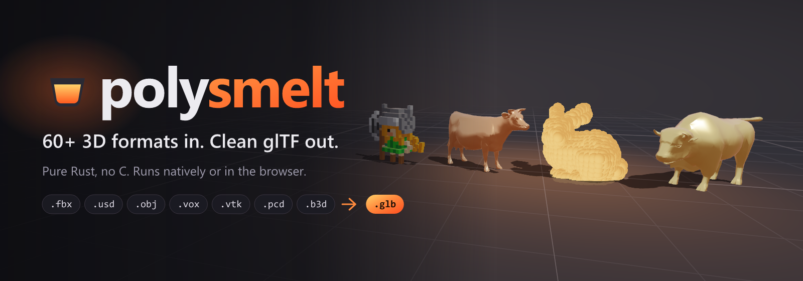

# polysmelt

<p align="center"><a href="https://azazel-labs.github.io/polysmelt/"></a></p>

<p align="center"><b><a href="https://azazel-labs.github.io/polysmelt/">Try it in your browser</a></b>: drop in a model or a folder and polysmelt reads it, lights it, plays its animations and hands it back as GLB.</p>

[](https://crates.io/crates/polysmelt)
[](https://docs.rs/polysmelt)
[](https://github.com/Azazel-Labs/polysmelt/actions/workflows/ci.yml)

**polysmelt reads more than 60 3D formats into one glTF 2.0 document, in pure Rust.** FBX,
USD, COLLADA, OBJ and 3DS; game formats from Quake to MikuMikuDance; motion capture; lidar
scans and gaussian splats; simulation meshes and 3D Tiles. Whatever goes in, you get the same
kind of document back, ready to write as GLB or FBX or to flatten into triangles.

## Why polysmelt

- **Every file comes out the same shape.** All readers follow one set of rules: +Y up and
  meters under a single `RootNode`, normals on every mesh, classic Phong materials turned into
  PBR by one formula, animations that start at zero, and the same names for the same facts. A
  3DS file from 1996 and a USD file from last week need the same code on your side.
  [What every reader guarantees →](docs/consistency.md)
- **Tested against the specs and against other tools.** About 1,900 conformance cases, each a
  file and exactly what it must become. Most are built from the format's specification; 75
  more, across 21 formats, check polysmelt against what assimp and other libraries read from
  the same file. Every GLB the tests write passes the Khronos glTF validator in CI.
  [How it's tested →](docs/testing.md)
- **Pure Rust, all the way down.** No C or C++ dependencies, no vendor SDKs, nothing to
  install. It builds for `wasm32-unknown-unknown`, and the
  [live demo](https://azazel-labs.github.io/polysmelt/) is this crate running in your browser.
- **Fast.** On GitHub's runners polysmelt loads OBJ, PLY, GLB and ASCII STL about 3 to 4 times
  faster than tobj, ply-rs, the gltf crate and stl_io, while doing more: welding vertices,
  building normals, posing skins. [Benchmarks →](docs/performance.md)
- **Lossless where it can be.** glTF passes through untouched, compression included. What
  other formats say about themselves (units, axes, tool, version) is kept, and `source_info()`
  tells you what the file declared, what was assumed and what was converted.

## Quick start

```sh
cargo add polysmelt
```

```rust no_run
use polysmelt::document::Pose;

fn main() -> Result<(), Box<dyn std::error::Error>> {
    // Any format polysmelt reads, told by the extension or else by the first bytes.
    // Textures and other files the model names are found beside it.
    let doc = polysmelt::open("models/robot.fbx")?;

    let info = doc.source_info();
    println!("{:?}, up {:?}: {} triangles", info.format, info.up_axis, doc.triangles());

    // Out as GLB with everything kept, or as flat, posed triangles.
    doc.write_glb(std::io::BufWriter::new(std::fs::File::create("robot.glb")?))?;
    let mesh = doc.flatten(Pose::Rest)?;
    Ok(())
}
```

A `Loader` picks what `open` doesn't: what to keep, where referenced files are found, and the
format.

```rust no_run
use polysmelt::{Format, Keep, Loader, assets::Folder};

fn main() -> polysmelt::Result<()> {
    let doc = Loader::new()
        .keep(Keep::ALL.with_animations(false))
        .assets(Folder::new("textures"))
        .format(Format::Obj)
        .open("scan.txt")?;
    let glb = doc.to_glb()?;
    Ok(())
}
```

From the command line, `cargo run --example convert -- in.fbx out.glb` converts a model and
`cargo run --example inspect -- in.fbx` prints what it holds.

## Formats

| Kind | Formats |
| --- | --- |
| Scenes and interchange | FBX, USD (`.usda` `.usdc` `.usdz`), glTF 2.0 and 1.0, COLLADA, 3DS, X3D and VRML, OpenGEX |
| Meshes and 3D printing | OBJ + MTL, STL, PLY, OFF, 3MF, AMF |
| CAD and modeling | SketchUp (3 to 2026, no SDK), DXF, LightWave, AC3D, XGL |
| Games and characters | VRM, MikuMikuDance, DirectX `.x`, Quake II and III, Doom 3, Inter-Quake Model, Valve SMD, MilkShape 3D, Blitz3D, OGRE, Irrlicht, MagicaVoxel |
| Motion capture | BVH, Acclaim ASF/AMC, C3D, TRC, HTR, VMD |
| Simulation | VTK (legacy and XML), Gmsh, Medit, OpenFlight |
| Scans and geospatial | LAS and LAZ, E57, PCD, `.xyz` `.pts` `.ptx` `.asc`, OGC 3D Tiles |
| Gaussian splats | 3DGS PLY, SuperSplat compressed PLY, `.splat`, `.spz`, SOG |
| Textures | PNG, JPEG, WebP, TGA, BMP, GIF, TIFF, PSD, DDS |

Out: GLB (plain, or meshopt-compressed), binary FBX 7.4, and a flat triangle mesh.
[Every format, what it reads and its cargo feature →](docs/formats.md)

## What you get back

A `Document` is a glTF 2.0 document: its JSON and its buffers. From it:

- `to_glb` and `write_glb` write it out; `to_fbx` and `write_fbx` write FBX.
- `flatten(Pose)` bakes it into plain triangles, lines and points with their materials, at
  rest, at bind or at any moment of an animation.
- `rig()` gives typed nodes, skins and animations to sample, for code that plays or retargets
  motion.
- `source_info()` says what the file was: format, version, tool, units and axes.
- `decode()` turns Draco, meshopt and quantized data into plain glTF any viewer reads.

[A tour of the API →](docs/guide.md) · [glTF tools: meshopt, packing, compression →](docs/gltf-tools.md)

## In the browser

Every reader is a cargo feature, and all of them build for WebAssembly. Without the `fs`
feature, models load from memory:

```rust no_run
use polysmelt::{Loader, assets::Memory, document::Pose};

fn show(gltf: Vec<u8>, bin: Vec<u8>, png: Vec<u8>) -> polysmelt::Result<()> {
    let assets = Memory::new().with("scene.bin", bin).with("albedo.png", png);
    let doc = Loader::new().assets(assets).read(gltf, "scene.gltf")?;
    let mesh = doc.flatten(Pose::Rest)?;
    Ok(())
}
```

[Cargo features, the minimal build and WebAssembly →](docs/features.md)

## Minimum Rust

Rust 1.96, which `openusd` (the `usd` feature, on by default) needs.

## License

MIT-0. See [LICENSE](LICENSE). The SketchUp reader (`src/formats/skp`) is ported from
[openskp](https://github.com/iamahsanmehmood/openskp) and is MIT: see
[its license](src/formats/skp/LICENSE-openskp).
